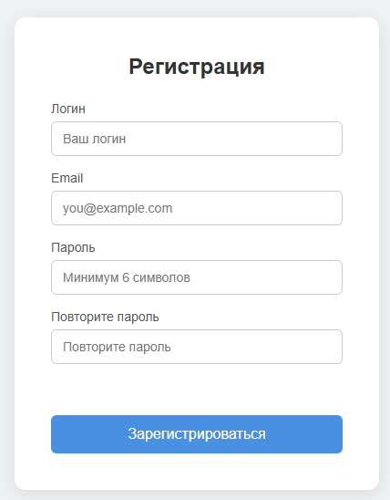
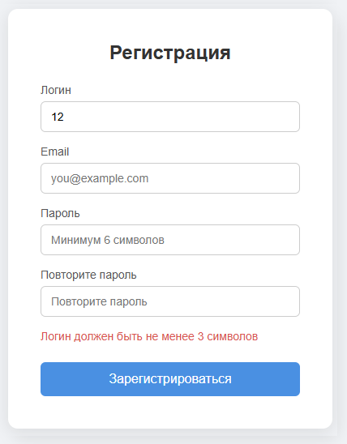
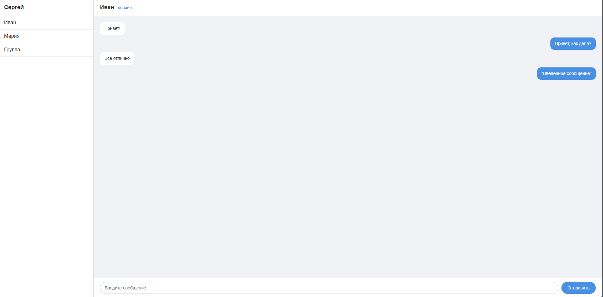

# AppSec Messenger

[Русская версия](README.ru.md)

Client-side messenger built with vanilla HTML, CSS, and JavaScript.

This project is part of a self-paced AppSec learning roadmap. It serves
as the foundation for the next stage of training — building a Flask
backend and demonstrating common web vulnerabilities (SQLi, XSS,
broken auth) on top of this client.

## Screenshots

### Registration


### Validation


### Chat


## Tech Stack

- HTML5
- CSS3 (Flexbox)
- Vanilla JavaScript (ES6+)

## Features

- Registration form with client-side validation:
  - Username (min 3 characters)
  - Email format
  - Password (min 6 characters)
  - Password confirmation
- Login saved to `localStorage` and displayed in the sidebar
- Chat interface with three contacts
- Switching between contacts
- Sending messages on click and Enter
- Auto-scroll to the latest message

## Project Structure

```
appsec-messenger/
├── index.html          Registration page
├── chat.html           Chat page
├── css/
│   └── style.css       Styles for both pages
├── js/
│   ├── auth.js         Form validation and login saving
│   └── chat.js         Chat logic (contacts, messages, switching)
└── screenshots/
```

## How to Run

1. Clone the repository:
   ```bash
   git clone https://github.com/foxxxymiron/appsec-messenger.git
   ```
2. Open the project folder in VS Code.
3. Open `index.html` with Live Server (or any local server).
4. Register with any valid data — you'll be redirected to the chat.

## Roadmap

- [x] **Stage 3** — Client-side part (HTML + CSS + JS)

Next: Flask backend, database, web vulnerabilities.

## Notes

Client-side validation is intended for UX only — it can be bypassed
via DevTools. Real validation must be implemented on the server
(see Stage 4+).

## Author

- **Ivantsov Maxim**
- GitHub: [@foxxxymiron](https://github.com/foxxxymiron)